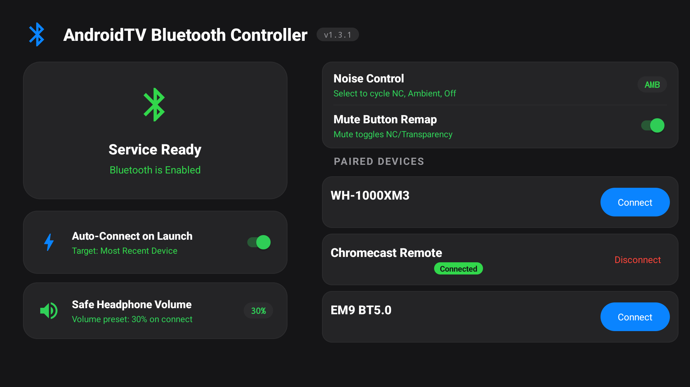

# AndroidTV Bluetooth Controller



A lightweight utility for Android TV and Android phones that gives you a **1-click UI** to connect/disconnect Bluetooth devices, or complete **ADB automation** support.

## Features

- **1-Click Connect:** Simple UI to instantly toggle connections from your TV or Phone.
- **Auto-Connect on Launch:** Automatically connect to your designated default or most recent Bluetooth device upon launching the app.
- **Battery Percentage Display:** Real-time battery indicator on device cards with dynamic health status color coding.
- **Safe Startup Volume:** Automatically set headphone media volume to a comfortable level (e.g. 30%, 40%, 50%) upon connection to protect your hearing.
- **Remote Button Mapping (QuickConnect):** Map any button on your Shield/TV remote (via Button Mapper) directly to `QuickConnectActivity` to connect headphones in the background without opening the main UI.
- **Sony Noise Control:** Switch a Sony headset between noise cancelling, ambient sound and off from the app.
- **Mute Button Remap:** A single mute press toggles noise cancelling and transparency on the headset, then restores the TV volume.
- **Mobile Quick Settings Tile & Widget:** Pull down the notification shade or tap a 1x1 Home Screen widget to toggle connection on Android phones and tablets.
- **ADB Automation:** Trigger connections/disconnections via terminal or automation scripts (Tasker, Home Assistant).
- **Recent Sorting:** Automatically sorts paired devices by most recently used.
- **Universal Compatibility:** Works seamlessly across Android TV, Google TV, and Android mobile (Android 8.0+).
- **Low Overhead:** Minimal impact on system resources and stays ready across restarts.

## Usage

### UI Method
Simply launch the **AndroidTV Bluetooth Controller** app:
- **Connect / Disconnect:** Click any paired device card.
- **Set as Default:** Long-click any device card to mark it as the default auto-connect device (indicated by a `★ DEFAULT` badge).
- **Auto-Connect Toggle:** Use the left panel card to enable or disable automatic connection on startup.
- **Safe Startup Volume:** Click the volume card on the left panel to cycle volume presets (`OFF`, `30%`, `40%`, `50%`, `60%`, `70%`, `80%`).

### Quick Connect (Remote Button Mapping)
You can map a button on your Shield or Android TV remote using **Button Mapper**:
- **Option 1 (App / Activity):** In Button Mapper, select **Applications > Quick Connect Bluetooth** (`com.saihgupr.btcontrol/.QuickConnectActivity`).
- **Option 2 (ADB / Intent Action):**
  ```bash
  adb shell am start -n com.saihgupr.btcontrol/.QuickConnectActivity
  ```
  *This instantly connects to your default/recent device in the background and closes cleanly without interrupting your playback.*

### Noise Control (Sony headphones)

Sony headsets that use the MDR protocol (`WH-1000XM`, `WF-1000XM`, `MDR-`) can change
noise cancelling and ambient mode straight from the app over Bluetooth. Nothing else is
installed on the headset.

- **In-app:** the **Noise Control** card in the right column cycles `NC → AMB → OFF`
  with a single click. The badge shows the last known mode.
- **Mute button:** off by default. Turn on the **Mute Button Remap** switch and a single press
  of the remote's mute toggles between noise cancelling and transparency.
  The app notices the mute, switches the headset, then restores the TV volume within about
  a second. Turn the switch off and mute behaves exactly like before, and the background
  watcher stops.

  For this to work the remote has to send the key to the TV box, not to the TV over IR:
  **Settings → Remotes & Accessories → your remote → Set up remote buttons →
  Volume control → Chromecast**. If it is set to the TV, Android never sees the press.

  While the remap is on, mute no longer mutes the TV. Use the volume keys for silence.

- **Button Mapper (other devices):** map any button to **Toggle Transparency**
  (`com.saihgupr.btcontrol/.ToggleTransparencyActivity`). It flips the mode and closes
  without opening the UI.
- **ADB / automation:**
  ```bash
  adb shell am broadcast -a com.saihgupr.btcontrol.ACTION_ANC \
    -n com.saihgupr.btcontrol/.BluetoothControlReceiver \
    -e mode transparency
  ```
  `mode` accepts `toggle`, `nc`, `transparency`, `ambient` or `off`, and the extra
  `name` / `address` targets a specific headset (otherwise your default device is used).

*Transparency uses the headset's voice focus mode: speech comes through, other ambient
noise is reduced. The first press can take a couple of seconds while the control link
comes up. On non-Sony headphones the card and broadcasts report that no Sony headphones
are connected.*

### Mobile Quick Settings & Widget
- **Quick Settings Tile:** Edit your Quick Settings shade on your phone and add the **BT Quick Connect** tile for 1-tap connection toggle and live battery status.
- **Home Screen Widget:** Long-press your home screen, select Widgets, and add the **Bluetooth Controller** 1x1 widget.

### ADB Method (Automation)

Connect or disconnect your Bluetooth devices by sending broadcast intents. This is perfect for mapping to remote buttons (via Button Mapper) or integrating into "Movie Mode" scenes.

### Connect a Device

**By Name (Recommended):**
```bash
adb shell am broadcast -a com.saihgupr.btcontrol.ACTION_CONNECT \
  -n com.saihgupr.btcontrol/.BluetoothControlReceiver \
  -e name "Your Device Name"
```
*Note: Name matching is case-insensitive (e.g., "LE_WH-1000XM4").*

**By MAC Address:**
```bash
adb shell am broadcast -a com.saihgupr.btcontrol.ACTION_CONNECT \
  -n com.saihgupr.btcontrol/.BluetoothControlReceiver \
  -e address "CC:98:8B:F4:97:BA"
```

### Disconnect a Device

```bash
adb shell am broadcast -a com.saihgupr.btcontrol.ACTION_DISCONNECT \
  -n com.saihgupr.btcontrol/.BluetoothControlReceiver \
  -e name "Your Device Name"
```


## Installation

### 1. Download & Install APK
Download the latest APK from the [Releases](https://github.com/saihgupr/AndroidTVBluetooth/releases) page.

**Option A: Via ADB (Fastest)**
```bash
adb install -r path/to/AndroidTVBluetooth.apk
```

**Option B: Manual (No PC needed)**
1. Transfer the APK to your TV (using a USB drive or a "Send Files to TV" app).
2. Open your TV's **File Explorer** and select the APK to install.
3. If prompted, allow "Install from Unknown Sources".

### 2. Grant Permissions
**Option A: Via ADB**
```bash
adb shell pm grant com.saihgupr.btcontrol android.permission.BLUETOOTH_CONNECT
```

**Option B: Manual (On TV)**
1. Go to your TV's **Settings > Apps > See all apps**.
2. Find **AndroidTV Bluetooth Controller**.
3. Select **Permissions** and ensure **Nearby Devices** (Bluetooth) is allowed.

### 3. Initialize
Launch the **AndroidTVBluetooth** app manually on your TV **one time** to move it out of the system's "stopped" state. You can close it immediately after.

---

### Alternative: Build from Source
If you prefer to build it yourself:
```bash
./gradlew assembleDebug
adb install -r app/build/outputs/apk/debug/AndroidTVBluetooth.apk
```

## Troubleshooting

If connection fails, check `logcat` to see which devices the TV detects:
```bash
adb logcat -d | grep "BtManagerHelper"
```
This will print a list of paired devices if your specified name was not found.

---

## Support the Project
This project is open-source and free. If you find it useful, consider giving it a star ⭐ or making a [donation](https://ko-fi.com/saihgupr) to support development.